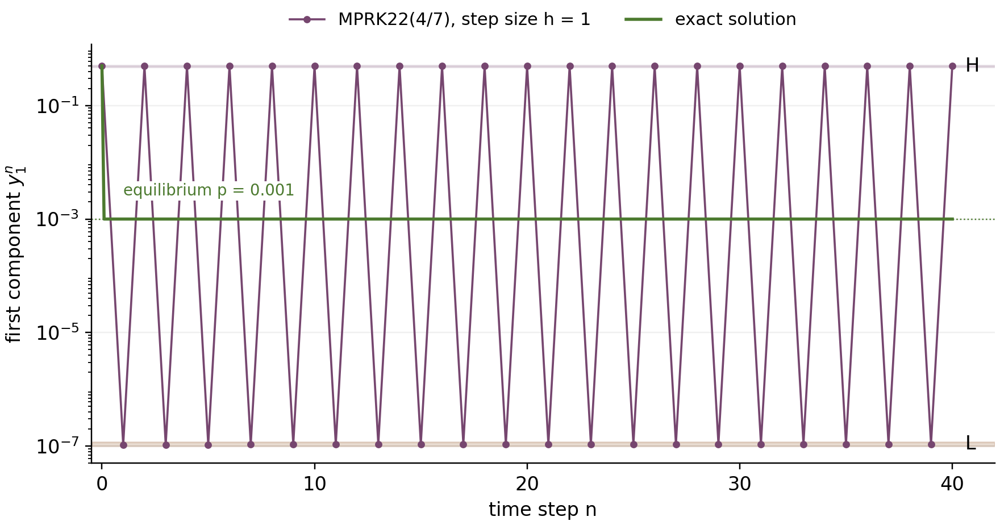
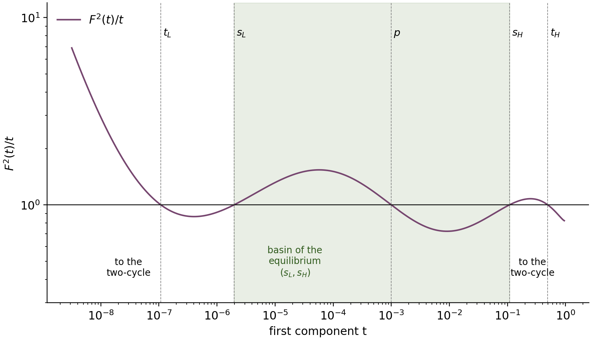
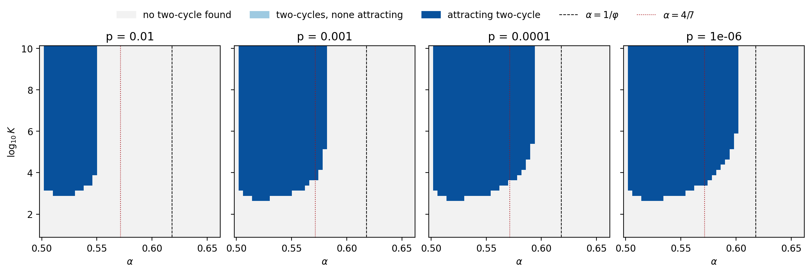

> Accessible text version of `paper.pdf`, generated from `paper.tex` with Pandoc 3.9 (cross-references and citation numbers resolved from the LaTeX build). The PDF is the reference typeset version; display mathematics is given in LaTeX notation.

# Introduction

## Why positivity-preserving schemes, and why global stability matters

Many models in chemistry, atmospheric science, marine biogeochemistry and epidemiology are *production–destruction systems* (PDS). The state $`y\in\mathbb R^N`$ collects concentrations, biomasses or population fractions, and each component is produced from, and destroyed into, other components:
``` math
\begin{equation}
\label{eq:pds}
 y_i'=\sum_{j\ne i}\bigl(p_{ij}(y)-p_{ji}(y)\bigr),\qquad p_{ij}(y)\ge0,\qquad i=1,\dots,N .
\end{equation}
```
Here $`p_{ij}`$ is the rate at which component $`i`$ is produced from component $`j`$. Such systems conserve the total mass $`\mathbf 1^Ty`$ and keep positive data positive. They are typically stiff, because reaction rates can differ by many orders of magnitude, so explicit methods need prohibitively small steps. Standard implicit methods remove the step-size restriction but can produce negative concentrations, which are physically meaningless and can break a model (for instance by making a growth law undefined).

Patankar’s idea \[22\] of weighting destruction terms by the ratio of new to old values, and its conservative modification by Burchard, Deleersnijder and Meister \[2\], lead to *modified Patankar–Runge–Kutta* (MPRK) schemes. These are linearly implicit, conserve mass exactly, and are positive for *every* step size. They exist at second and third order \[19, 20\], in strong-stability-preserving form \[5\], and at arbitrary order through deferred correction (MPDeC) \[21\]; a closely related second-order scheme for biochemical systems is due to Bruggeman, Burchard, Kooi and Sommeijer \[1\]. Their selling point is robustness with large steps, for example in ecosystem models coupled to ocean physics, where the step is dictated by transport rather than by the fastest reaction.

Large steps raise a question that classical theory answers for linear methods through A-stability: does the numerical solution still approach the correct steady state? For an MPRK scheme the iteration is nonlinear even when the PDS is linear, and conservation makes every steady state a non-hyperbolic fixed point. Izgin, Kopecz and Meister developed a centre-manifold stability theory for this situation \[10, 11\]. It shows, for example, that MPRK22$`(\alpha)`$ with $`\alpha\ge1/2`$ has a stable steady state for every step size and converges to it from *nearby* initial values. The theory is local: it says nothing about initial values far from the steady state.

## The conjecture

*MPRK schemes in general.* An MPRK scheme is obtained from an explicit $`s`$-stage Runge–Kutta method with coefficients $`a_{kl}`$ ($`l<k`$) and weights $`b_k`$; this Butcher tableau is called the *underlying Runge–Kutta tableau*. For the PDS (1), with $`d_{ij}=p_{ji}`$, the stages and the update are
``` math
\begin{equation}
\label{eq:mprkgeneral}
\begin{aligned}
 y^{(k)}_i&=y^n_i+\Delta t\sum_{l<k}a_{kl}\sum_{j\ne i}\Bigl(p_{ij}(y^{(l)})\frac{y^{(k)}_j}{\pi^{(k)}_j}-d_{ij}(y^{(l)})\frac{y^{(k)}_i}{\pi^{(k)}_i}\Bigr),\qquad k=1,\dots,s,\\
 y^{n+1}_i&=y^n_i+\Delta t\sum_{k}b_k\sum_{j\ne i}\Bigl(p_{ij}(y^{(k)})\frac{y^{n+1}_j}{\sigma_j}-d_{ij}(y^{(k)})\frac{y^{n+1}_i}{\sigma_i}\Bigr),
\end{aligned}
\end{equation}
```
where the *Patankar weight denominators* $`\pi^{(k)},\sigma>0`$ are computed from earlier stages \[2, 19, 20\]. Each stage is a linear system whose matrix is a nonsingular $`M`$-matrix with unit column sums in the conservative case, so positivity and mass are preserved for every $`\Delta t>0`$. “Nonnegative tableau” means $`a_{kl}\ge0`$ and $`b_k\ge0`$ for all entries. Explicit tableaux have structural zeros ($`a_{kl}=0`$ for $`l\ge k`$); by a positive tableau we mean that all *nonzero* coefficients are positive. MPRK22$`(\alpha)`$ (Section 2) and MPRK43II$`(\gamma)`$ (Section 6.3) are instances.

Izgin, Kopecz, Meister and Schilling describe the desired global property as follows (Section 1, p. 3 of the arXiv version \[14\]; the journal version is \[13\]):

> “In summary, we are looking for MPRK schemes for which a stable steady state $`y^*`$ of a positive and conservative linear system $`y'=Ay`$, becomes a stable fixed point of the MPRK scheme for all time step sizes $`\Delta t`$, and in addition, the iterates $`y^n`$ tend to $`y^*`$ for all initial values $`y^0`$ that satisfy $`n_i^Ty^0=n_i^Ty^*`$.”

Here the vectors $`n_i`$ span the linear invariants of $`A`$, that is, $`n_i^TA=0`$. This is an informal description; the following definition is our formalisation of it, with the quantifiers made explicit.

<div id="def:global" class="definition">

**Definition 1** (Global linear stability). An MPRK scheme is *globally linearly stable* if the following holds for every positive and conservative linear system $`y'=Ay`$ (the off-diagonal entries of $`A`$ are nonnegative and its column sums vanish) with a stable steady state $`y^*`$, every step size $`\Delta t>0`$, and every positive initial value $`y^0`$ with the same linear invariants as $`y^*`$: (i) $`y^*`$ is a stable fixed point of the scheme, and (ii) the iterates satisfy $`y^n\to y^*`$.

</div>

The conjecture itself is stated in the abstract of \[13\]. It was prompted by the discovery that MPDeC(8), whose tableau has negative entries, is only locally stable \[15\]:

> “Our conjecture is that this is a result of negative Runge–Kutta (RK) parameters of MPDeC(8) and that linear stability is indeed global if the RK parameters are nonnegative.”

At the end of Section 1 (p. 4 of \[14\]) the aim of that paper is stated as justifying “the conjecture that this local linear stability behavior, which is unknown from general linear methods, only occurs for MPRK schemes if the Butcher tableau of the underlying RK scheme contains negative values.” The source states the conjecture in words only. The following formal statement is ours; it is the natural literal reading of the sentence above combined with the description of global stability quoted earlier, and it is this universal statement that we refute.

<div id="conj:IKMS" class="conjecture">

**Conjecture 2** (Izgin–Kopecz–Meister–Schilling; our formalisation). *Every MPRK scheme whose underlying Runge–Kutta tableau has only nonnegative entries is globally linearly stable in the sense of Definition 1.*

</div>

The evidence offered in \[13\] for nonnegative tableaux consists of experiments with MPRK22$`(\alpha)`$ on the *symmetric* system $`y_1'=-ay_1+ay_2`$, $`y_2'=ay_1-ay_2`$ with $`a=200`$ and $`\Delta t=1`$, whose steady state is $`(1/2,1/2)`$ (Section 3 and Figure 3 of \[14\]). The authors also note (Section 4, p. 11) that for the members “relevant in practice, i. e. $`\alpha\approx1`$” no restriction on the initial value could be found. Izgin’s thesis \[9\] (Chapter 6) calls investigating or proving the claim “of high importance”. The conjecture sentence above is quoted from the abstract of the journal version, as deposited in the publisher’s metadata; the same sentence in the arXiv abstract differs from it only by one comma (elsewhere the two abstracts differ in further punctuation, and the journal abstract adds three sentences on MPRK22$`(\alpha)`$ with $`\alpha<1/2`$). The other quotations are from the arXiv version.

## What fails, and how

Part (i) of Definition 1 holds for MPRK22$`(\alpha)`$ with $`\alpha\ge1/2`$ \[10, 11\]. We show that part (ii) fails. The failure mode is new in this context. The locally-but-not-globally stable MPRK schemes found so far (all with negative tableau entries) converge from some initial values to *spurious fixed points*, that is, to wrong steady states of the scheme \[13\]. In our examples there is no spurious fixed point at all: the physical steady state is the only positive fixed point (Lemma 3, Proposition 14). Instead, the scheme has an *attracting periodic orbit of period two*, which coexists with the locally attracting steady state. The numerical solution then alternates for ever between two states that are far from the steady state and from each other, while remaining positive and conserving mass exactly.

Periodic orbits created by time discretisation are classical. Spurious steady states and period-two orbits of Runge–Kutta and other implicit methods at large steps were analysed by Iserles \[7\], by Hairer, Iserles and Sanz-Serna \[3\], by Iserles, Peplow and Stuart \[8\], by Yee, Sweby and Griffiths \[28\] and by Humphries \[6\], and are surveyed in the monograph of Stuart and Humphries \[26\]. There the spurious behaviour comes from the nonlinearity of the differential equation. Here the differential equation is *linear*, the tableau is positive, and the nonlinearity comes solely from the Patankar weights that make the scheme positive. Torlo, Öffner and Ranocha \[27\] and Izgin, Öffner and Torlo \[16\] studied transient oscillations and order reduction of Patankar-type schemes; a persistent periodic attractor is a different phenomenon. Recent work on step-size controllers designed to keep such integrators stable \[17\] shows that large steps and stability remain an active practical concern.

## Contributions

The status of each result is given in brackets: <span class="sans-serif">\[proof\]</span> means a written proof; <span class="sans-serif">\[certified\]</span> means a computer-assisted proof in exact rational interval arithmetic, with a standalone verifier and a JSON certificate (Section 10); <span class="sans-serif">\[exploratory\]</span> means floating-point numerics without proof.

1.  **Counterexample** (Theorem 5) <span class="sans-serif">\[certified\]</span>. For MPRK22$`(4/7)`$, $`A=\begin{psmallmatrix}-9990&10\\9990&-10\end{psmallmatrix}`$, $`\Delta t=1`$ and $`y^0=(1/2,1/2)`$, the iterates converge to an attracting positive two-cycle, while $`y^*=(10^{-3},1-10^{-3})`$ is the unique positive fixed point and is locally asymptotically stable. Hence Conjecture 2 is false.

2.  **Complete phase portrait** of this example (Theorem 6) <span class="sans-serif">\[certified and proof\]</span>. There is exactly one attracting and one repelling two-cycle; the basin of $`y^*`$ is the set of initial values with $`s_L<y_1^0<s_H`$, where $`s_L\approx1.97\cdot10^{-6}`$ and $`s_H\approx0.1081`$; initial values with $`y_1^0\notin[s_L,s_H]`$ converge to the attracting cycle, and the two boundary points form the repelling cycle.

3.  **Mechanism and parameter range.** A heuristic explanation (Section 3); two-cycles for every $`\alpha\in(1/2,1/\varphi)`$, $`\varphi=(1+\sqrt5)/2`$, at sufficiently asymmetric equilibria and large steps (Theorem 9) <span class="sans-serif">\[proof\]</span>; an explicit three-parameter region with two-cycles (Theorem 10) <span class="sans-serif">\[certified\]</span>; explicit parameter sets with *attracting* two-cycles, each covering all steps $`K\ge10^4`$ at once (Theorem 11) <span class="sans-serif">\[certified\]</span>; and a computed phase diagram (Figure 3) <span class="sans-serif">\[exploratory\]</span>.

4.  **Beyond two species and beyond MPRK22.** An attracting two-cycle for a three-species reversible chain $`\mathrm A\rightleftharpoons\mathrm B\rightleftharpoons\mathrm C`$ (Theorem 12) <span class="sans-serif">\[certified\]</span> and for the third-order scheme MPRK43II$`(37/50)`$ (Theorem 13) <span class="sans-serif">\[certified\]</span>. The frequency of two-cycles in random networks, and their occurrence for other schemes <span class="sans-serif">\[exploratory\]</span>.

5.  **Where global convergence holds.** No spurious positive fixed points in any dimension for $`1/2\le\alpha\le1`$ (Proposition 14) <span class="sans-serif">\[proof\]</span>; global convergence on all two-species linear systems for $`\alpha=1/2`$ (Theorem 15) and $`\alpha=1`$ (Theorem 16) <span class="sans-serif">\[proof; polynomial identities certified\]</span>.

6.  **Consequences for users** (Section 8) and a **refined conjecture** (Conjecture 17).

## Roadmap

Section 2 fixes notation, reduces the two-species problem to a scalar map $`F`$, and proves the basic facts about its fixed point. Section 3 explains, before any theorem uses it, why large steps and asymmetric equilibria create two-cycles. Section 4 proves the counterexample and determines its complete phase portrait. Section 5 describes how far the phenomenon extends in the parameters. Section 6 treats three species and a third-order scheme. Section 7 collects the positive results. Section 8 discusses consequences for users, Section 9 states a refined conjecture and open problems, and Section 10 describes the certificates and how to replay them.

# Setting, notation and the scalar map

## The MPRK22$`(\alpha)`$ scheme

MPRK22$`(\alpha)`$ \[19\] is built on the explicit two-stage Runge–Kutta method with $`a_{21}=\alpha`$, $`b_1=1-\frac1{2\alpha}`$ and $`b_2=\frac1{2\alpha}`$. All three coefficients are nonnegative exactly when $`\alpha\ge1/2`$, and positive when $`\alpha>1/2`$. For $`\alpha=1`$ it is the original scheme of \[2\]. Applied with step size $`\Delta t`$ to a linear PDS $`y'=Ay`$, for which $`p_{ij}(y)=a_{ij}y_j`$ ($`i\ne j`$), one step $`y\mapsto y^+`$ reads (Section 2.1 of \[13\])
``` math
\begin{equation}
\label{eq:scheme}
 u=(I-\alpha\Delta t A)^{-1}y,\qquad
 \sigma_i=y_i^{1-1/\alpha}u_i^{1/\alpha},\qquad
 q_i=\frac{\beta y_i+\gamma u_i}{\sigma_i},\qquad
 y^+=\bigl(I-\Delta t A\operatorname{diag}(q)\bigr)^{-1}y,
\end{equation}
```
with $`\beta=b_1`$ and $`\gamma=b_2`$. The vector $`u`$ is the intermediate stage and the $`q_i`$ are the *Patankar weights*. The Patankar denominator $`\sigma`$ is also the first-order embedded solution used for error estimation (Section 8). Both matrices in (3) are nonsingular $`M`$-matrices with nonnegative inverses, so $`y>0`$ implies $`u>0`$ and $`y^+>0`$; moreover $`\mathbf 1^Ty^+=\mathbf 1^Ty`$.

We write $`r=1/\alpha`$ and note that $`q_i=Q(y_i/u_i)`$, where
``` math
\begin{equation}
\label{eq:Q}
 Q(v)=\beta v^{r}+\gamma v^{r-1}=v^{r-1}(\beta v+\gamma),\qquad
 Q(1)=1,\qquad Q'(v)=v^{r-2}\bigl(\beta r v+\gamma(r-1)\bigr).
\end{equation}
```
For $`1/2\le\alpha\le1`$ we have $`r\ge1`$, $`\beta\ge0`$ and $`\gamma>0`$, so $`Q`$ is strictly increasing on $`(0,\infty)`$. For the counterexample, $`\alpha=4/7`$, $`r=7/4`$ and $`Q(v)=\frac18(v+7)v^{3/4}`$.

## The two-species test problem and its scalar map

Every positive conservative $`2\times2`$ system is $`y_1'=-ay_1+by_2`$, $`y_2'=ay_1-by_2`$ with $`a,b>0`$; this is equation (4) of \[13\]. Its steady state on the unit-mass simplex is $`(p,1-p)`$ with $`p=b/(a+b)`$, and the scheme depends on the step only through the *stiffness parameter*
``` math
\begin{equation}
\label{eq:K}
 K=(a+b)\Delta t=|\lambda|\Delta t,\qquad \lambda=-(a+b),
\end{equation}
```
where $`\lambda`$ is the nonzero eigenvalue of $`A`$. In the notation $`z=\Delta t\lambda`$ of \[13\], $`K=-z`$. Thus we may normalise the matrix to $`A_p=\begin{psmallmatrix}-(1-p)&p\\1-p&-p\end{psmallmatrix}`$ with step $`K`$. The exact solution from $`(t,1-t)`$ has first component $`p+(t-p)e^{-(a+b)s}`$ at time $`s`$, so every positive initial value converges monotonically to the steady state.

Because mass is conserved and the scheme is homogeneous of degree one, it suffices to follow the first component $`t=y_1`$ on the simplex. Solving the two linear systems in (3) by hand gives the stage
``` math
\begin{equation}
\label{eq:u}
 u(t)=\frac{t+\alpha Kp}{1+\alpha K},\qquad 1-u(t)=\frac{(1-t)+\alpha K(1-p)}{1+\alpha K},
\end{equation}
```
the ratios $`v_1=t/u`$ and $`v_2=(1-t)/(1-u)`$, the weights $`q_1=Q(v_1)`$ and $`q_2=Q(v_2)`$, and the exact scalar map
``` math
\begin{equation}
\label{eq:map}
 F(t)=F_{K,p}(t)=\frac{t+Kp\,q_2}{1+K\bigl((1-p)q_1+p\,q_2\bigr)}.
\end{equation}
```
The denominator minus the numerator equals $`1-t+K(1-p)q_1>0`$, so $`F`$ maps $`(0,1)`$ into itself. No clipping or modified denominator is used. To study large steps we also use $`\kappa=1/K`$. Dividing numerator and denominator by $`K`$ gives
``` math
\begin{equation}
\label{eq:mapkappa}
 F(t)=\frac{\kappa t+p\,q_2}{\kappa+(1-p)q_1+p\,q_2},\qquad u=\frac{\kappa t+\alpha p}{\kappa+\alpha},
\end{equation}
```
a continuous function of $`(\kappa,t)\in[0,\infty)\times(0,1)`$. Its value at $`\kappa=0`$ is the *limit map* $`\Phi_p`$ of equation (9) below.

Table 1 lists the symbols. Each symbol has one meaning throughout.

<div id="tab:notation">

|  |  |
|:---|:---|
| $`\alpha`$ | parameter of MPRK22$`(\alpha)`$; $`r=1/\alpha`$, $`\beta=1-\frac1{2\alpha}`$, $`\gamma=\frac1{2\alpha}`$, $`m=r-1`$ |
| $`Q(v)`$ | Patankar weight function $`\beta v^r+\gamma v^{r-1}`$, equation (4) |
| $`\Delta t`$ | step size |
| $`p`$ | first component of the steady state of a two-species system (equilibrium fraction) |
| $`K,\ \kappa`$ | stiffness parameter $`K=(a+b)\Delta t`$, equation (5), and $`\kappa=1/K`$ |
| $`t,\ u,\ v_1,\ v_2`$ | first component, stage (6), and the ratios $`t/u`$ and $`(1-t)/(1-u)`$ |
| $`F=F_{K,p}`$ | scalar MPRK22 map (7); $`G(t)=F(F(t))-t`$ |
| $`\Phi_p`$ | limit map $`\lim_{K\to\infty}F_{K,p}`$, equation (9) |
| $`L,\ H`$ | rational trapping intervals near $`0`$ and near $`1/2`$ (Theorem 5) |
| $`t_L,\,t_H;\ s_L,\,s_H`$ | points of the attracting and of the repelling two-cycle |
| $`\pi`$ | normalised steady state of an $`N`$-species system |
| $`\varphi`$ | golden ratio $`(1+\sqrt5)/2`$, so $`1/\varphi=(\sqrt5-1)/2\approx0.618`$ |
| $`\varpi,\ \eta_i,\ \mu_i`$ | exponent parameter and Patankar denominators of MPRK43II (Section 6.3) |

Notation.

</div>

## The steady state: uniqueness and local stability

<div id="lem:fixed" class="lemma">

**Lemma 3** (<span class="sans-serif">\[proof\]</span>). *Let $`\alpha\ge1/2`$, $`K>0`$ and $`0<p<1`$.*

1.  *The only fixed point of $`F_{K,p}`$ in $`(0,1)`$ is $`p`$.*

2.  *$`F_{K,p}'(p)=\dfrac{-K^2+2\alpha K+2}{2(1+\alpha K)(1+K)}`$ and $`|F'_{K,p}(p)|<1`$, so $`p`$ is locally asymptotically stable.*

3.  *Every zero of $`G=F^2-\mathrm{id}`$ in $`(0,1)\setminus\{p\}`$ lies on an orbit of prime period two. Every two-cycle has one point on each side of $`p`$; hence two distinct zeros on the same side of $`p`$ lie on different two-cycles.*

</div>

<div class="proof">

*Proof.* (a) *Goal: reduce the fixed-point equation to one strictly increasing function evaluated at two points.* Put $`c=\alpha K`$, $`z=t/p`$, $`w=(1-t)/(1-p)`$ and $`\theta(x)=(1+c)x/(x+c)`$. By (6), $`v_1=\theta(z)`$ and $`v_2=\theta(w)`$. Clearing the denominator in (7), a fixed point satisfies $`t(1-p)q_1=(1-t)p\,q_2`$, that is $`zQ(\theta(z))=wQ(\theta(w))`$. Both sides are values of the function
``` math
f(x)=xQ(\theta(x))=\beta(1+c)^r\frac{x^{r+1}}{(x+c)^r}+\gamma(1+c)^{r-1}x^r(x+c)^{1-r},
```
whose two terms are strictly increasing for $`x>0`$, because
``` math
\frac{d}{dx}\frac{x^{r+1}}{(x+c)^r}=\frac{x^r(x+(r+1)c)}{(x+c)^{r+1}}>0,\qquad \frac{d}{dx}\,x^r(x+c)^{1-r}=\frac{x^{r-1}(x+rc)}{(x+c)^r}>0,
```
while $`\beta\ge0`$ and $`\gamma>0`$. Hence $`z=w`$, and $`pz+(1-p)w=1`$ gives $`z=w=1`$, i.e. $`t=p`$. Conversely, $`u(p)=p`$, all weights equal $`Q(1)=1`$, and $`F(p)=p`$.

\(b\) Differentiating (7) at $`t=p`$ gives the stated formula. It is the stability function
``` math
R(z)=\frac{-z^2-2\alpha z+2}{2(1-\alpha z)(1-z)}
```
of MPRK22$`(\alpha)`$ from Section 2.1 of \[13\] (derived in \[10\]) evaluated at $`z=-K`$. The denominator minus the numerator is $`2K+(2\alpha+1)K^2>0`$, and the denominator plus the numerator is $`4+(4\alpha+2)K+(2\alpha-1)K^2>0`$; hence $`|F'(p)|<1`$.

\(c\) If $`G(x)=0`$ and $`x\ne p`$, then $`F(x)\ne x`$ by (a), so $`x`$ has prime period two. If $`x<y`$ form a two-cycle, then $`F(x)-x=y-x>0`$ and $`F(y)-y<0`$, so a fixed point lies strictly between them; by (a) it is $`p`$. ◻

</div>

<div id="rem:flip" class="remark">

**Remark 4** (Stiff limit of the local multiplier). As $`K\to\infty`$, $`F'_{K,p}(p)\to-1/(2\alpha)`$, which is $`-7/8`$ for $`\alpha=4/7`$ and $`-1`$ for $`\alpha=1/2`$. For large steps the steady state is therefore close to a flip (period-doubling) situation, and period two is the natural failure mode. For $`\alpha=1/2`$ the multiplier is exactly $`-(K-2)/(K+2)`$, so local convergence becomes very slow for large $`K`$.

</div>

# The mechanism: why large steps and asymmetry create two-cycles

This section is heuristic; the statements are proved in Sections 4 and 5. Consider a very large step, $`K\to\infty`$. Then the stage (6) satisfies $`u\to(p,1-p)`$: the first, implicit-Euler-like stage lands essentially on the steady state. The Patankar weights become $`q_1=Q(t/p)`$ and $`q_2=Q((1-t)/(1-p))`$, and (8) becomes the *limit map*
``` math
\begin{equation}
\label{eq:limit}
 \Phi_p(t)=\frac{p\,Q\bigl(\frac{1-t}{1-p}\bigr)}{(1-p)\,Q\bigl(\frac tp\bigr)+p\,Q\bigl(\frac{1-t}{1-p}\bigr)}.
\end{equation}
```
Suppose the steady state is very asymmetric, $`p\ll1`$, and the current state is macroscopic, say $`t=1/2`$.

- *Crushing step.* Species 1 is far *above* its equilibrium value: its ratio $`t/p`$ is large and it receives the large weight $`Q(t/p)\approx\beta(t/p)^r`$. The final linear solve then overshoots far below the equilibrium, to $`\Phi_p(t)\approx C(t)\,p^{r+1}\ll p`$.

- *Return step.* Now species 1 is far *below* equilibrium, with ratio $`\delta/p\approx Cp^r\ll1`$, and receives the small weight $`Q(\delta/p)\approx\gamma(\delta/p)^{r-1}`$. In the next step its destruction is weighted by this small factor; the two competing terms in the denominator of (9) have ratio of order $`p^{r(r-1)-1}`$.

If $`r(r-1)>1`$, that is $`\alpha<1/\varphi`$, the destruction term becomes negligible and species 1 is thrown back to a macroscopic value close to $`1`$. So the second iterate of a macroscopic state is again macroscopic. Combined with local attraction of $`p`$ and the behaviour near the endpoints, this forces period-two points away from $`p`$, coexisting with the locally attracting steady state (Lemma 3).

*Why the experiments of \[13\] did not show it.* Their test system is symmetric, $`p=1/2`$, with $`K=400`$. Both ingredients of the mechanism above are missing: there is no small $`p`$ to create the scale separation, and the step is moderate. This is an explanation, not a proof that asymmetry and large steps are necessary. In our grid scans (Figure 3, exploratory) every two-cycle found had $`p\le10^{-2}`$ and $`K\gtrsim10^{2.75}`$, and none was found at $`p=1/2`$.

# The counterexample and its complete phase portrait

This section turns the mechanism into a proof for one concrete system: we certify an attracting two-cycle (Theorem 5) and then determine exactly which initial values converge to the steady state and which to the cycle (Theorem 6).

<div id="thm:witness" class="theorem">

**Theorem 5** (Counterexample; <span class="sans-serif">\[certified\]</span>, certificates C1 and C2). *Apply MPRK22$`(4/7)`$ with step size $`\Delta t=1`$ to
``` math
\begin{equation}
\label{eq:witness}
 y'=Ay,\qquad A=\begin{pmatrix}-9990&10\\9990&-10\end{pmatrix},\qquad y^0=\begin{pmatrix}1/2\\1/2\end{pmatrix}.
\end{equation}
```
All nonzero tableau coefficients, $`4/7`$, $`1/8`$ and $`7/8`$, are positive. The steady state $`y^*=(1/1000,\,999/1000)^T`$ is the unique positive fixed point of the scheme on the unit-mass simplex and is locally asymptotically stable, with multiplier $`F'(1/1000)=-349959993/400110007`$. Nevertheless the iterates converge to a positive orbit of prime period two. This orbit attracts every initial value whose first component lies in
``` math
\begin{equation}
\label{eq:traps}
 L=\left[10^{-7},\ 117\cdot10^{-9}\right]\quad\text{or in}\quad H=\left[\tfrac{12}{25},\ \tfrac{507}{1000}\right].
\end{equation}
```*

</div>

<div class="proof">

*Proof.* *Reduction.* Here $`a+b=10^4`$, so $`K=10^4`$ and $`p=10^{-3}`$, and (6)–(7) become
``` math
u(t)=\frac{7t+40}{40007},\qquad Q(v)=\frac{(v+7)v^{3/4}}8,\qquad F(t)=\frac{t+10\,Q\bigl(\frac{1-t}{1-u}\bigr)}{1+9990\,Q\bigl(\frac tu\bigr)+10\,Q\bigl(\frac{1-t}{1-u}\bigr)}.
```
The statements about the steady state follow from Lemma 3 with $`K=10^4`$ and $`\alpha=4/7`$.

*Strategy: trap, swap, contract.* We show that $`F`$ maps $`L`$ into the interior of $`H`$ and $`H`$ into the interior of $`L`$, and that $`F^2`$ is a contraction on each interval. The sizes of $`L`$ and $`H`$ reflect the mechanism of Section 3: a macroscopic state near $`1/2`$ is crushed to about $`10^{-7}`$, and returns.

*Certified facts.* Exact rational interval arithmetic (Section 10) gives the enclosures in Table 2. Certificate C2 also proves $`F'<0`$ on all of $`(0,1)`$ (Theorem 6(a)), so the image of each interval lies between the images of its endpoints.

*Conclusion.* Because $`F(H)\subset L`$, the mean-value theorem gives, for $`t,t'\in H`$,
``` math
|F^2(t)-F^2(t')|\le\sup_H|F'|\,\sup_L|F'|\,|t-t'|,
```
and the same bound holds on $`L`$. By Table 2,
``` math
\sup_L|F'|\cdot\sup_H|F'|\le 1.6823\cdot10^{6}\times5.333\cdot10^{-7}\le 0.8971<1 .
```
By the contraction mapping theorem, $`F^2`$ has a unique fixed point $`t_H\in H`$ and a unique fixed point $`t_L\in L`$, which attract all of $`H`$ and $`L`$ respectively. Since $`F`$ swaps the intervals, $`F(t_H)=t_L`$ and $`F(t_L)=t_H`$; since $`L`$ and $`H`$ are disjoint, the period is exactly two. Finally, $`1/2\in H`$. ◻

</div>

<div id="tab:certificate">

| Quantity | C1 enclosure | C2 enclosure | required |
|:---|:---|:---|:---|
| $`F(L)`$ | $`[0.48017,\,0.50674]`$ | $`[0.480178,\,0.506740]`$ | $`\subset\operatorname{int}H`$ |
| $`F(H)`$ | $`[1.005,\,1.165]\cdot10^{-7}`$ | $`[1.0175,\,1.1508]\cdot10^{-7}`$ | $`\subset\operatorname{int}L`$ |
| $`F'`$ on $`L`$ | $`[-1\,683\,000,\,-1\,452\,000]`$ | $`\sup|F'|\le1.6823\cdot10^{6}`$ | negative |
| $`F'`$ on $`H`$ | $`[-5.66,\,-4.30]\cdot10^{-7}`$ | $`\sup|F'|\le5.333\cdot10^{-7}`$ | negative |
| Lipschitz bound for $`F^2`$ | $`0.9526`$ | $`0.8971`$ | $`<1`$ |

Certified enclosures for Theorem 5. Decimal numbers are outward roundings of exact rational endpoints recorded in the certificates. C1 is the original certificate (one interval evaluation per trap); C2 uses monotone images and 64 subintervals per trap.

</div>

For orientation, $`t_H\approx0.4935222293`$ and $`t_L\approx1.081476034\cdot10^{-7}`$. The exact solution has first component $`10^{-3}+0.499e^{-10^4s}`$, which equals $`10^{-3}`$ to plotting accuracy at every positive integer time. The numerical solution is therefore too large by a factor of about $`500`$ on even steps and too small by a factor of about $`10^4`$ on odd steps, for ever (Figure 1).

<figure id="fig:trajectory" data-latex-placement="ht">

<figcaption>Illustration (decimal arithmetic with 80 digits; not part of the proof): first component of MPRK22<span class="math inline">(4/7)</span> for (10) on a logarithmic axis. Shaded bands are the trapping intervals <span class="math inline"><em>L</em></span> and <span class="math inline"><em>H</em></span>; the green curve is the exact solution, which reaches the equilibrium <span class="math inline"><em>p</em> = 10<sup>−3</sup></span> within the first step.</figcaption>
</figure>

Theorem 5 shows that some initial values fail. The next theorem says exactly which ones.

<div id="thm:portrait" class="theorem">

**Theorem 6** (Complete phase portrait of the counterexample; <span class="sans-serif">\[certified and proof\]</span>, certificate C2). *For the system (10):*

1.  *$`F`$ is strictly decreasing on $`(0,1)`$.*

2.  *$`G=F^2-\mathrm{id}`$ has exactly five zeros in $`(0,1)`$, namely $`t_L<s_L<p<s_H<t_H`$, where $`s_H\in[0.10805096916,\,0.10805096917]`$, $`s_L=F(s_H)\approx1.9651694\cdot10^{-6}`$, and $`t_L`$, $`t_H`$ are as in Theorem 5.*

3.  *$`\{t_L,t_H\}`$ is an attracting two-cycle with multiplier $`(F^2)'(t_H)\approx0.7711`$, and $`\{s_L,s_H\}`$ is a repelling two-cycle with multiplier $`\approx1.1558`$.*

4.  *For an initial value $`y^0=(t,1-t)`$ with $`0<t<1`$: $`y^n\to y^*`$ if and only if $`s_L<t<s_H`$. Every $`t\in(0,s_L)\cup(s_H,1)`$ converges to the attracting two-cycle, and $`t\in\{s_L,s_H\}`$ stays on the repelling cycle.*

*The basin of the steady state has length $`s_H-s_L\approx0.10805`$. Thus, for an initial mass fraction $`t`$ drawn uniformly from $`(0,1)`$ (normalised Lebesgue measure), the probability of reaching the wrong, periodic limit is about $`89\%`$.*

</div>

<div class="proof">

*Proof.* *Certified input (C2).* (i) $`F'<0`$ on $`(0,1)`$. Near the endpoints $`F'`$ is singular like $`t^{-1/4}`$ or $`(1-t)^{-1/4}`$. There the certificate encloses $`s\,F'(s^4)`$ and $`s\,F'(1-s^4)`$ for $`s\in[0,1/32]`$; these functions are continuous up to $`s=0`$ and certified negative. On $`[2^{-20},\,1-2^{-20}]`$ it encloses $`F'`$ directly. (ii) On $`(p,1)`$: $`(F^2)'<1`$ on $`[p,\,p+p/20]`$; $`G<0`$ on $`[p+p/20,\,0.108]`$; $`G(0.108)<0<G(0.1081)`$ and $`(F^2)'>1`$ on $`[0.108,\,0.1081]`$; $`G>0`$ on $`[0.1081,\,12/25]`$; $`(F^2)'<1`$ on $`H`$; $`G<0`$ on $`[507/1000,\,19/20]`$; and $`F^2(t)<F(F(1))<19/20`$ on $`[19/20,1)`$, where $`F(1)\approx5.92\cdot10^{-9}`$ is the value of the continuous extension of $`F`$ at $`1`$. Away from zeros, the sign of $`G`$ on a cell $`[x,y]`$ follows from monotonicity of $`F^2`$ and two point enclosures: $`F^2(y)<x`$ gives $`G<0`$, and $`F^2(x)>y`$ gives $`G>0`$. (iii) Enclosures of the two multipliers and of $`s_H-s_L`$.

*Zeros of $`G`$ in $`(p,1)`$.* On $`[p,\,p+p/20]`$, $`G`$ is strictly decreasing with $`G(p)=0`$, so it is negative except at $`p`$. On $`[0.108,\,0.1081]`$, $`G`$ is strictly increasing and changes sign once; this zero is $`s_H`$. On $`H`$, $`G`$ is strictly decreasing with $`G(12/25)>0>G(507/1000)`$; this zero is $`t_H`$. Elsewhere $`G`$ has a fixed sign. Hence the zeros in $`(p,1)`$ are exactly $`s_H<t_H`$, with $`G<0`$ on $`(p,s_H)`$, $`G>0`$ on $`(s_H,t_H)`$ and $`G<0`$ on $`(t_H,1)`$.

*Zeros of $`G`$ in $`(0,p)`$.* Since $`F`$ is strictly decreasing with $`F(p)=p`$, it maps $`(0,p)`$ into $`(p,1)`$. For $`x\in(0,p)`$ and $`y=F(x)`$ we have $`G(y)=F(F^2(x))-F(x)`$, so $`G(y)<0`$ if and only if $`F^2(x)>x`$, i.e. $`G(x)>0`$. Thus $`F`$ maps the zeros of $`G`$ in $`(0,p)`$ bijectively onto those in $`(p,F(0^+))`$ and reverses the sign pattern. Therefore the zeros in $`(0,p)`$ are $`s_L=F(s_H)`$ and $`t_L=F(t_H)`$, and $`G>0`$ on $`(0,t_L)`$, $`G<0`$ on $`(t_L,s_L)`$ and $`G>0`$ on $`(s_L,p)`$.

*Dynamics.* $`F^2`$ is continuous and strictly increasing, so every orbit of $`F^2`$ is monotone. On an interval between consecutive zeros where $`G>0`$, the orbit increases and stays below the right-hand zero (because $`F^2`$ is increasing and fixes that zero), hence converges to it; where $`G<0`$ it decreases to the left-hand zero. On $`(0,t_L)`$ the orbit increases to $`t_L`$. Consequently $`F^{2n}(t)\to p`$ for $`t\in(s_L,s_H)`$, $`F^{2n}(t)\to t_L`$ for $`t\in(0,s_L)`$, and $`F^{2n}(t)\to t_H`$ for $`t\in(s_H,1)`$. Applying the continuous map $`F`$ gives the odd iterates. The multipliers come from (iii), and the basin length $`s_H-s_L`$ is certified in $`[0.10804900399,\,0.10804900400]`$. ◻

</div>

<figure id="fig:portrait" data-latex-placement="ht">

<figcaption>Illustration of Theorem 6 (floating point; the theorem itself is certified): the ratio <span class="math inline"><em>F</em><sup>2</sup>(<em>t</em>)/<em>t</em></span> crosses <span class="math inline">1</span> exactly at <span class="math inline"><em>t</em><sub><em>L</em></sub></span>, <span class="math inline"><em>s</em><sub><em>L</em></sub></span>, <span class="math inline"><em>p</em></span>, <span class="math inline"><em>s</em><sub><em>H</em></sub></span>, <span class="math inline"><em>t</em><sub><em>H</em></sub></span>. Initial values in the shaded interval <span class="math inline">(<em>s</em><sub><em>L</em></sub>, <em>s</em><sub><em>H</em></sub>)</span> converge to the steady state; all others converge to the two-cycle <span class="math inline">{<em>t</em><sub><em>L</em></sub>, <em>t</em><sub><em>H</em></sub>}</span>.</figcaption>
</figure>

<div class="remark">

**Remark 7** (A derivative-free route). The certified inequalities $`F^2(1/4)>0.26961>1/4`$, $`F^2(3/4)<0.66338<3/4`$ and $`F([1/4,3/4])\subset(0,10^{-3})`$ already give a positive two-cycle by the intermediate value theorem and Lemma 3(c), without any derivative bound (certificate C1). This alone refutes part (ii) of Definition 1, because an orbit started on the cycle never converges.

</div>

<div class="remark">

**Remark 8** (Singer’s theorem does not apply). For interval maps with negative Schwarzian derivative, Singer’s theorem \[25\] bounds the number of attracting orbits. We evaluated the Schwarzian derivative of $`F`$ numerically on a logarithmic grid and found it positive at most grid points <span class="sans-serif">\[exploratory\]</span>, so this route is not available; Theorem 6 uses monotonicity of $`F`$ instead.

</div>

# How far the failure extends

## An interval of method parameters

The counterexample is not an isolated accident: here we show that two-cycles exist for a whole interval of methods. The mechanism of Section 3 works whenever $`r(r-1)>1`$, that is for $`1/2<\alpha<1/\varphi\approx0.618`$.

<div id="thm:family" class="theorem">

**Theorem 9** (Two-cycles for $`1/2<\alpha<1/\varphi`$; <span class="sans-serif">\[proof\]</span>). *For every $`\alpha\in(1/2,1/\varphi)`$ there is $`p_0\in(0,1/2)`$ such that for every $`p\in(0,p_0)`$ there is $`K_0(\alpha,p)`$ with the following property: for every $`K>K_0`$ the map $`F_{K,p}`$ has at least two distinct positive two-cycles. This is an existence statement; Theorems 10 and 11 give explicit parameter sets and attraction.*

</div>

<div class="proof">

*Proof.* *Plan.* For the limit map $`\Phi_p`$ we find three points $`x_0<1/2<x_2`$ above $`p`$ at which $`\Phi_p^2-\mathrm{id}`$ has signs $`-,+,-`$. We transfer these signs to all large finite $`K`$; the intermediate value theorem and Lemma 3(c) then give two different two-cycles.

*Exponents.* Let $`r=1/\alpha`$ and $`m=r-1`$. Then $`\varphi<r<2`$, $`0<m<1`$ and $`r(r-1)>1`$; moreover $`\beta,\gamma>0`$.

*Transfer from $`K=\infty`$ to finite $`K`$.* By (8), $`F`$ is jointly continuous in $`(\kappa,t)\in[0,\infty)\times(0,1)`$, takes values in $`(0,1)`$, and equals $`\Phi_p`$ at $`\kappa=0`$. Hence, for fixed $`x\in(0,1)`$, the second iterate $`F(\kappa,F(\kappa,x))`$ is continuous in $`\kappa`$ at $`\kappa=0`$, as a composition of continuous maps; that is, $`F^2_{K,p}(x)\to\Phi_p^2(x)`$ as $`K\to\infty`$. Strict signs of $`\Phi_p^2(x)-x`$ at finitely many points therefore persist for all sufficiently large $`K`$. Only this pointwise convergence at three points is used.

*Positive sign at $`1/2`$ for small $`p`$.* Fix $`t\in(0,1)`$ and let $`p\downarrow0`$. Since $`Q(z)\sim\beta z^r`$ as $`z\to\infty`$, (9) gives $`\Phi_p(t)\sim C(t)p^{r+1}`$ with $`C(t)=Q(1-t)/(\beta t^r)>0`$. Put $`\delta_p=\Phi_p(t)`$. Then $`\delta_p/p\sim C(t)p^r\to0`$ and $`Q(z)\sim\gamma z^{r-1}`$ as $`z\downarrow0`$, so
``` math
\frac{(1-p)Q(\delta_p/p)}{p\,Q\bigl(\frac{1-\delta_p}{1-p}\bigr)}\sim\gamma C(t)^{r-1}p^{r(r-1)-1}\to0,
```
and (9) gives $`\Phi_p^2(t)\to1`$. In particular $`\Phi_p^2(1/2)>1/2`$ for all sufficiently small $`p`$; fix such a $`p<1/2`$.

*Negative sign near $`p`$.* Differentiating (9) gives $`\Phi_p'(p)=-Q'(1)=-r/2`$, so $`(\Phi^2_p-\mathrm{id})'(p)=r^2/4-1<0`$. Choose $`x_0\in(p,1/2)`$ with $`\Phi_p^2(x_0)<x_0`$.

*Negative sign near $`1`$.* $`\Phi_p`$ extends continuously to $`[0,1]`$ with $`\Phi_p(0)=1`$ and $`\Phi_p(1)=0`$, and $`1-\Phi_p(t)\sim a_0t^m`$ as $`t\downarrow0`$ and $`\Phi_p(1-\varepsilon)\sim a_1\varepsilon^m`$ as $`\varepsilon\downarrow0`$, where
``` math
a_0=\frac{(1-p)\gamma p^{-m}}{p\,Q(1/(1-p))},\qquad a_1=\frac{p\gamma(1-p)^{-m}}{(1-p)\,Q(1/p)}.
```
Hence $`1-\Phi_p^2(1-\varepsilon)\sim a_0a_1^m\varepsilon^{m^2}`$, which exceeds $`\varepsilon`$ for small $`\varepsilon`$ because $`m^2<1`$. Choose $`x_2\in(1/2,1)`$ with $`\Phi_p^2(x_2)<x_2`$.

*Conclusion.* For all large $`K`$, $`G_{K,p}`$ has signs $`-,+,-`$ at $`x_0`$, $`1/2`$, $`x_2`$, so it has a zero in $`(x_0,1/2)`$ and a zero in $`(1/2,x_2)`$. Both lie above $`p`$, so by Lemma 3(c) they lie on two different two-cycles. ◻

</div>

The number $`1/\varphi`$ is the boundary of this sufficient asymptotic argument. It is not proved to be a sharp threshold.

## An explicit region and explicit attracting sets

Theorem 9 gives no constants. The following two certified results do.

<div id="thm:region" class="theorem">

**Theorem 10** (An explicit region of non-convergence; <span class="sans-serif">\[certified\]</span>, certificate C6). *For every $`\alpha\in[53/100,\,56/100]`$, every $`p\in[10^{-4},10^{-3}]`$ and every $`K\in[10^4,10^6]`$, the map $`F_{K,p}`$ of MPRK22$`(\alpha)`$ has a positive two-cycle. In particular, for these parameters MPRK22$`(\alpha)`$ does not converge to the steady state from every positive initial value.*

</div>

<div class="proof">

*Proof.* For finite $`K`$ and $`\alpha<1`$, $`F`$ extends continuously to $`[0,1]`$, because the factor $`v_2^{r-1}`$ in $`q_2`$ vanishes at $`t=1`$; its value there is $`F(1)=\kappa/(\kappa+(1-p)Q(1/u(1)))\in(0,1)`$, so $`G(1)=F(F(1))-1<0`$. The certificate covers the parameter box by sub-boxes in which $`\alpha`$, $`p`$ and $`K`$ all enter as intervals (real powers are enclosed by logarithm and exponential series with rational remainder bounds). On each sub-box it certifies $`G(x)>0`$ at a rational test point $`x=2^{-j}>2p`$. The intermediate value theorem then gives a zero of $`G`$ in $`(x,1)`$, which lies on a two-cycle by Lemma 3(c). ◻

</div>

<div id="thm:attracting" class="theorem">

**Theorem 11** (Explicit attracting two-cycles; <span class="sans-serif">\[certified\]</span>, certificate C4).

1.  *For each $`\alpha\in\{13/25,\,11/20,\,4/7\}`$ and each $`p\in\{10^{-3},10^{-4},10^{-5}\}`$, the map $`F_{K,p}`$ has an attracting positive two-cycle for *every* $`K\ge10^4`$, and so does the limit map $`\Phi_p`$.*

2.  *Every $`(\alpha,p,K)`$ with $`\alpha\in\frac47[1-10^{-4},\,1+10^{-4}]`$, $`p\in10^{-3}[1-10^{-3},\,1+10^{-3}]`$ and $`K\in10^4[1-10^{-3},\,1+10^{-3}]`$ has an attracting positive two-cycle.*

</div>

<div class="proof">

*Proof.* For each case the certificate covers the parameter set by boxes in which $`\kappa=1/K\in[0,10^{-4}]`$ (and, in (b), also $`\alpha`$ and $`p`$) enter as intervals; part (a) uses 1002 boxes for its 9 cases. For each box it exhibits rational intervals $`L`$ and $`H`$ and certifies, for all parameters in the box at once: $`F'<0`$ on $`L`$ and on $`H`$, $`F(H)\subset\operatorname{int}L`$, $`F(L)\subset\operatorname{int}H`$, and $`\sup_L|F'|\sup_H|F'|<1`$ (the largest bound used is $`0.9971`$). The argument of Theorem 5 then applies to every parameter in the box. ◻

</div>

Part (a) has a practical reading: at these parameters, once the step is large enough to produce the attracting cycle, making it *larger* never removes it. Part (b) is an explicit form of the robustness of the counterexample under perturbation of all three parameters.

## A computed phase diagram

Figure 3 shows where two-cycles were found numerically <span class="sans-serif">\[exploratory\]</span>. For each $`p`$ the attracting two-cycles occupy a region $`1/2<\alpha\le\alpha_{\max}(p)`$ and $`K\ge K_{\min}(\alpha,p)`$, with $`\alpha_{\max}=0.548`$, $`0.580`$, $`0.592`$ and $`0.600`$ for $`p=10^{-2}`$, $`10^{-3}`$, $`10^{-4}`$ and $`10^{-6}`$ on this grid, and $`K_{\min}`$ between about $`10^{2.75}`$ (near $`\alpha=0.52`$) and $`10^{6}`$ (near $`\alpha_{\max}`$). The upper edge approaches $`1/\varphi`$ only slowly as $`p\to0`$, consistent with the exponent $`r(r-1)-1\to0`$. No two-cycle was found for $`\alpha\ge0.604`$ or for $`\alpha=1/2`$ (consistent with Theorem 15). Wherever a two-cycle was found on this grid, an attracting one was found too.

<figure id="fig:phase" data-latex-placement="ht">

<figcaption>Exploratory phase diagram (floating point, grid-based; not a proof): presence of attracting two-cycles of two-species MPRK22<span class="math inline">(<em>α</em>)</span> in the <span class="math inline">(<em>α</em>, log<sub>10</sub><em>K</em>)</span> plane for four equilibrium fractions <span class="math inline"><em>p</em></span>. Grid spacing <span class="math inline">0.004</span> in <span class="math inline"><em>α</em></span> and <span class="math inline">0.25</span> in <span class="math inline">log<sub>10</sub><em>K</em></span>. Dashed line: <span class="math inline"><em>α</em> = 1/<em>φ</em></span>; dotted line: <span class="math inline"><em>α</em> = 4/7</span>. Data: <code>exploratory/X1_phase_diagram.csv</code>.</figcaption>
</figure>

# Beyond two species and beyond MPRK22

## A three-species reversible chain

Two-species systems might seem special. The phenomenon persists in a chemically meaningful three-species network: a reversible chain with a short-lived intermediate.

<div id="thm:three" class="theorem">

**Theorem 12** (Three species; <span class="sans-serif">\[certified\]</span>, certificate C3). *Consider the reaction chain $`\mathrm A\rightleftharpoons\mathrm B\rightleftharpoons\mathrm C`$ with rate constants $`k_{\mathrm A\to\mathrm B}=10`$, $`k_{\mathrm B\to\mathrm A}=10^4`$, $`k_{\mathrm B\to\mathrm C}=10^4`$ and $`k_{\mathrm C\to\mathrm B}=1`$, that is $`y'=Ay`$ with
``` math
A=\begin{pmatrix}-10&10^4&0\\10&-2\cdot10^4&1\\0&10^4&-1\end{pmatrix},
```
and apply MPRK22$`(4/7)`$ with $`\Delta t=1`$. The steady state $`\pi=(1000,\,1,\,10000)/11001`$ is the unique positive fixed point on the unit-mass simplex and is locally asymptotically stable. The scheme has an attracting positive two-cycle near
``` math
(0.035874,\ 0.33085,\ 0.63327)\ \leftrightarrow\ (0.17761,\ 7.2405\cdot10^{-10},\ 0.82239),
```
and the orbit of $`y^0=(1/3,1/3,1/3)`$ converges to it.*

</div>

<div class="proof">

*Proof.* *Reduction.* Mass is conserved, so we use the coordinates $`x=(y_{\mathrm A},y_{\mathrm B})`$ with $`y_{\mathrm C}=1-y_{\mathrm A}-y_{\mathrm B}`$; let $`\mathcal G`$ be the induced planar map. Its Jacobian follows by differentiating (3): with $`M=I-\Delta tA\operatorname{diag}(q)`$ we have $`dy^+=M^{-1}(dy+\Delta tA\operatorname{diag}(y^+)\,dq)`$, $`dq_i=Q'(v_i)(dy_i/u_i-y_i\,du_i/u_i^2)`$ and $`du=(I-\alpha\Delta tA)^{-1}dy`$.

*Strategy.* As in Theorem 5, but with parallelograms $`B_a=a+S_a[-1,1]^2`$ and $`B_b=b+S_b[-1,1]^2`$ adapted to the strongly anisotropic linearisation, and with the norm $`\|S_a^{-1}x\|_\infty`$.

*Certified facts (C3).* Both parallelograms lie in the open simplex and are disjoint. By mean-value enclosures with interval Jacobians, $`\mathcal G(B_a)\subset\operatorname{int}B_b`$ and $`\mathcal G(B_b)\subset\operatorname{int}B_a`$. The interval matrix $`S_a^{-1}D\mathcal G(B_b)\,D\mathcal G(B_a)S_a`$ has $`\infty`$-norm at most $`0.5398`$. Since $`B_a`$ is convex and $`\mathcal G(B_a)\subset B_b`$, the mean-value inequality shows that $`\mathcal G^2`$ is a contraction of $`B_a`$ with factor at most $`0.5398`$; it has a unique fixed point there, which attracts $`B_a`$ and has prime period two because $`B_a\cap B_b=\emptyset`$. An interval enclosure of the exact orbit of $`(1/3,1/3,1/3)`$ enters $`B_b`$ after $`31`$ steps.

*Steady state.* $`A\pi=0`$ exactly, and $`\pi`$ is a fixed point. The $`2\times2`$ Jacobian at $`\pi`$ has certified trace $`\approx-1.2826`$ and determinant $`\approx0.3567`$, which satisfy the Jury conditions $`|\det|<1`$ and $`|\mathrm{tr}|<1+\det`$; so both eigenvalues ($`\approx-0.408`$ and $`-0.875`$) lie inside the unit disc. Uniqueness of the positive fixed point is Proposition 14. ◻

</div>

In a floating-point sample of $`200`$ uniformly random initial states on the simplex, $`197`$ converged to this cycle and $`3`$ to the steady state <span class="sans-serif">\[exploratory\]</span>.

## Random networks

To gauge how special such examples are, we iterated MPRK22$`(\alpha)`$ on random conservative linear networks <span class="sans-serif">\[exploratory\]</span>: $`100`$ three-species and $`50`$ four-species systems with all off-diagonal rates log-uniform in $`[10^{-3},10^{3}]`$, steps $`\Delta t\in\{10,10^3,10^5\}`$, four initial states per system, $`5000`$ steps each. For $`\alpha\in\{0.52,\,0.55,\,4/7\}`$ many systems had an initial state whose iterates numerically converged to a period-two orbit (to relative tolerance $`10^{-11}`$): for three species, $`53`$, $`40`$ and $`15`$ of $`100`$ at $`\Delta t=10`$, and $`74`$, $`62`$ and $`51`$ at $`\Delta t=10^3`$. For $`\alpha=0.6`$ this occurred for $`2`$ of $`100`$ three-species and $`1`$ of $`50`$ four-species systems at $`\Delta t=10^5`$ only. For $`\alpha\in\{0.62,\,2/3,\,0.8,\,1\}`$ every run converged to the steady state. For $`\alpha=1/2`$ no run ended on a two-cycle, but at $`\Delta t\ge10^3`$ almost no run had converged after $`5000`$ steps. Full tables are in `exploratory/X2_random_networks.csv`.

## A third-order scheme

The conjecture concerns all MPRK schemes, not only MPRK22. We therefore test a third-order scheme, which we first define completely.

*Definition of MPRK43II$`(\gamma)`$*<span id="sec:mprk43def" label="sec:mprk43def"></span>. Kopecz and Meister \[20\] (we cite equation numbers of the arXiv version \[24\]: Lemma 2.4, case II; Theorem 2.7, equations (63); scheme (68) with $`\delta=1`$) take the third-order tableau
``` math
a_{21}=\tfrac23,\quad a_{31}=\tfrac23-\tfrac1{4\gamma},\quad a_{32}=\tfrac1{4\gamma},\quad b_1=\tfrac14,\quad b_2=\tfrac34-\gamma,\quad b_3=\gamma,\qquad \tfrac38\le\gamma\le\tfrac34,
```
and the exponent parameters $`\varpi=3a_{21}(a_{31}+a_{32})b_3`$ and $`a_{21}`$, with $`\beta_2=1/(2a_{21})`$, $`\beta_1=1-\beta_2`$. For a PDS (1), one step $`y^n\mapsto y^{n+1}`$ consists of four linear solves (all sums over $`j\ne i`$, $`d_{ij}=p_{ji}`$):
``` math
\begin{align*}
 y^{(2)}_i&=y^n_i+a_{21}\Delta t\sum_j\Bigl(p_{ij}(y^n)\frac{y^{(2)}_j}{y^n_j}-d_{ij}(y^n)\frac{y^{(2)}_i}{y^n_i}\Bigr),\\
 y^{(3)}_i&=y^n_i+\Delta t\sum_j\Bigl(\bigl(a_{31}p_{ij}(y^n)+a_{32}p_{ij}(y^{(2)})\bigr)\frac{y^{(3)}_j}{\eta_j}-\bigl(a_{31}d_{ij}(y^n)+a_{32}d_{ij}(y^{(2)})\bigr)\frac{y^{(3)}_i}{\eta_i}\Bigr),\\
 \sigma_i&=y^n_i+\Delta t\sum_j\Bigl(\bigl(\beta_1p_{ij}(y^n)+\beta_2p_{ij}(y^{(2)})\bigr)\frac{\sigma_j}{\mu_j}-\bigl(\beta_1d_{ij}(y^n)+\beta_2d_{ij}(y^{(2)})\bigr)\frac{\sigma_i}{\mu_i}\Bigr),\\
 y^{n+1}_i&=y^n_i+\Delta t\sum_j\Bigl(\sum_{k=1}^3b_kp_{ij}(y^{(k)})\frac{y^{n+1}_j}{\sigma_j}-\sum_{k=1}^3b_kd_{ij}(y^{(k)})\frac{y^{n+1}_i}{\sigma_i}\Bigr),
\end{align*}
```
with $`y^{(1)}=y^n`$ and Patankar weight denominators
``` math
\eta_i=(y^n_i)^{1-1/\varpi}\,(y^{(2)}_i)^{1/\varpi},\qquad \mu_i=(y^n_i)^{1-1/a_{21}}\,(y^{(2)}_i)^{1/a_{21}} .
```
The third solve is an embedded MPRK22$`(a_{21})`$ step that supplies the denominators $`\sigma`$ of the final solve. For a linear system $`p_{ij}(y)=a_{ij}y_j`$, and every solve is a $`2\times2`$ linear system when $`N=2`$. For $`\gamma=37/50`$ the coefficients are $`a_{31}=73/222`$, $`a_{32}=25/74`$, $`b=(1/4,1/100,37/50)`$, and $`\varpi=74/75`$, so the exponents are $`1/\varpi=75/74`$ and $`1/a_{21}=3/2`$. All nonzero coefficients are positive. This written definition is what certificate C7 evaluates. As an independent cross-check, it agrees with the implementation in PositiveIntegrators.jl \[23\], and our floating-point version converges with order $`3`$ on a nonlinear test problem <span class="sans-serif">\[exploratory\]</span>. A scan of two-species problems <span class="sans-serif">\[exploratory\]</span> found two-cycles for $`\gamma\ge0.72`$ at small $`p`$ and large $`K`$, and none for $`\gamma\le0.7`$.

<div id="thm:mprk43" class="theorem">

**Theorem 13** (A third-order counterexample; <span class="sans-serif">\[certified\]</span>, certificate C7). *For MPRK43II$`(37/50)`$, all nonzero tableau coefficients are positive: $`a_{21}=2/3`$, $`a_{31}=73/222`$, $`a_{32}=25/74`$, $`b=(1/4,\,1/100,\,37/50)`$. Apply it with $`\Delta t=1`$ to $`y'=Ay`$ with $`A=\begin{psmallmatrix}-9\,999\,000&1000\\9\,999\,000&-1000\end{psmallmatrix}`$, so that $`K=10^7`$ and $`p=10^{-4}`$. The steady state is a fixed point with $`|F'(p)|<1`$ ($`F'(p)\approx-0.6250`$), so it is locally asymptotically stable. Yet every initial value with first component in $`H=[0.4935,\,0.5035]`$, in particular $`(1/2,1/2)`$, or in an explicit interval $`L\approx[4.78,\,5.14]\cdot10^{-13}`$, converges to an attracting two-cycle.*

</div>

<div class="proof">

*Proof.* The certificate evaluates the exact two-species step of the scheme defined above (four $`2\times2`$ Patankar solves) together with its derivative, obtained by forward-mode automatic differentiation in interval arithmetic. It certifies $`F'<0`$ on $`L`$ and on $`H`$, $`F(H)\subset\operatorname{int}L`$, $`F(L)\subset\operatorname{int}H`$, $`\sup_L|F'|\,\sup_H|F'|\le0.882`$, $`F(p)=p`$ and $`|F'(p)|<1`$. The conclusion follows as in Theorem 5. Whether $`p`$ is the only positive fixed point of this scheme is neither needed nor claimed. ◻

</div>

We also scanned the strong-stability-preserving family SSPMPRK22$`(a_{21},b_{10})`$ of Huang and Shu \[5\], whose stability is analysed in \[4\] and which contains MPRK22$`(\alpha)`$ as SSPMPRK22$`(0,\alpha)`$ <span class="sans-serif">\[exploratory\]</span>. Two-cycles occurred for $`(0.2,\,0.6)`$ and $`(0.1,\,0.55)`$ at $`p\le10^{-3}`$ and $`K\ge10^4`$, but not for the member $`(0.5,\,1)`$.

# Where global convergence does hold

We now turn from failures to positive results: spurious fixed points are impossible for $`1/2\le\alpha\le1`$ in any dimension, and for two species MPRK22$`(1/2)`$ and MPRK22$`(1)`$ always converge to the steady state.

<div id="prop:alln" class="proposition">

**Proposition 14** (No spurious positive fixed points; <span class="sans-serif">\[proof\]</span>). *Let $`A\in\mathbb R^{N\times N}`$ be irreducible with nonnegative off-diagonal entries and $`\mathbf 1^TA=0`$, and let $`\pi>0`$ with $`A\pi=0`$ and $`\mathbf 1^T\pi=1`$. For $`\Delta t>0`$ and $`1/2\le\alpha\le1`$, the only positive fixed point of MPRK22$`(\alpha)`$ with mass $`M>0`$ is $`M\pi`$.*

</div>

<div class="proof">

*Proof.* *Goal: a maximum principle for the ratios $`y_i/\pi_i`$.* The resolvent $`P=(I-\alpha\Delta tA)^{-1}=\int_0^\infty e^{-s}e^{\alpha\Delta t\,sA}\,ds`$ is nonnegative and fixes $`\pi`$, so $`T=\operatorname{diag}(\pi)^{-1}P\operatorname{diag}(\pi)`$ is row-stochastic. Let $`y>0`$ be a fixed point and put $`x_i=y_i/\pi_i`$ and $`z=Tx`$, so that $`z_i=u_i/\pi_i`$ and every $`z_i`$ lies in $`[\min x,\max x]`$. The fixed-point equation of the final stage is $`A\operatorname{diag}(q)y=0`$; by irreducibility $`\ker A=\operatorname{span}\pi`$, so $`q_iy_i=d\,\pi_i`$ for a constant $`d>0`$, i.e. $`x_iQ(x_i/z_i)=d`$ for all $`i`$. Since $`Q`$ is increasing with $`Q(1)=1`$, an index with $`x_i=\max x`$ gives $`d\ge\max x`$, and an index with $`x_i=\min x`$ gives $`d\le\min x`$. Hence $`x`$ is constant and $`y=M\pi`$. Conversely, $`M\pi`$ is fixed. ◻

</div>

The two positive results for two species use different measures of distance. For $`\alpha=1/2`$ the right one is the log-odds distance to the steady state,
``` math
\begin{equation}
\label{eq:logodds}
 V(t)=\Bigl|\ln\frac{t/(1-t)}{p/(1-p)}\Bigr|,
\end{equation}
```
which for two species is Hilbert’s projective distance between $`(t,1-t)`$ and $`(p,1-p)`$.

<div id="thm:half" class="theorem">

**Theorem 15** ($`\alpha=1/2`$; <span class="sans-serif">\[proof\]</span>, polynomial identities certified by C5). *For MPRK22$`(1/2)`$, every $`K>0`$ and every $`0<p<1`$, we have $`V(F(t))<V(t)`$ for all $`t\in(0,1)\setminus\{p\}`$, and there is $`\rho_{1/2}(K,p)<1`$ with $`V(F(t))\le\rho_{1/2}V(t)`$ for all $`t\in(0,1)`$. Hence every positive two-species MPRK22$`(1/2)`$ orbit converges to the steady state, geometrically in the log-odds distance. The rate satisfies $`\rho_{1/2}\ge|K-2|/(K+2)`$, which tends to $`1`$ as $`K\to\infty`$.*

</div>

<div class="proof">

*Proof.* *Explicit map.* For $`\alpha=1/2`$ we have $`\beta=0`$, $`\gamma=1`$, $`q_1=t/u`$ and $`q_2=(1-t)/(1-u)`$. With $`U=2t+Kp`$ and $`W=2(1-t)+K(1-p)`$ we get $`u=U/(2+K)`$, $`1-u=W/(2+K)`$ and $`F=N/D`$, where
``` math
N=tUW+Kp(1-t)(2+K)U,\qquad D=UW+K(1-p)t(2+K)W+Kp(1-t)(2+K)U .
```
*Three identities* (verified symbolically by C5):
``` math
\begin{align*}
 D-N&=(1-t)UW+K(1-p)t(2+K)W>0,\\
 N-tD&=K(2+K)(p-t)\bigl[K\bigl(p(1-t)+t(1-p)\bigr)+2t(1-t)\bigr],\\
 \Phi_{1/2}:=Nt(1-p)^2-p^2(1-t)(D-N)&=(t-p)\,\Psi,
\end{align*}
```
where, writing $`s=1-t`$ and $`q=1-p`$,
``` math
\Psi=4ts(ps+qt)+2K\bigl(p^2s^2+4pqst+q^2t^2\bigr)+K^2pq\bigl(ps^2+3pst+3qst+qt^2\bigr)>0 .
```
*Lyapunov property.* Let $`X(t)=\frac{t/(1-t)}{p/(1-p)}`$, so that $`V=|\ln X|`$. Suppose $`t>p`$, so $`X(t)>1`$. The second identity gives $`F(t)<t`$, hence $`X(F(t))<X(t)`$. Since $`F/(1-F)=N/(D-N)`$, the inequality $`X(F(t))\,X(t)>1`$ is equivalent to $`\Phi_{1/2}>0`$, which holds by the third identity. So $`1/X(t)<X(F(t))<X(t)`$, i.e. $`V(F(t))<V(t)`$. The case $`t<p`$ is symmetric, with all inequalities reversed.

*Convergence and rate.* $`V`$ is continuous on $`(0,1)`$, vanishes only at $`p`$, and tends to $`\infty`$ at both ends. The ratio $`V(F(t))/V(t)`$ extends continuously to $`[0,1]`$: it tends to $`0`$ at the endpoints, where $`V\to\infty`$ while $`F`$ stays in a compact subinterval of $`(0,1)`$, and to $`|F'(p)|=|K-2|/(K+2)`$ at $`t=p`$, because the log-odds coordinate is a smooth change of variable fixing $`p`$. The ratio is $`<1`$ everywhere on $`[0,1]`$, so its maximum $`\rho_{1/2}`$ is $`<1`$, and $`V(F^n(t))\le\rho_{1/2}^nV(t)\to0`$. ◻

</div>

The log-odds distance is *not* monotone along orbits for $`1/2<\alpha<1`$ (numerically, one-step ratios up to $`1.6`$ occur), consistent with the two-cycles found there. For $`\alpha=1/2`$ with three species it is not monotone either, and in the random-network study MPRK22$`(1/2)`$ often converged very slowly <span class="sans-serif">\[exploratory\]</span>; we do not know whether it is globally convergent for $`N\ge3`$.

<div id="thm:alphaone" class="theorem">

**Theorem 16** ($`\alpha=1`$; <span class="sans-serif">\[proof\]</span>, identities certified by C5). *For MPRK22$`(1)`$, every $`0<p<1`$, $`K>0`$ and $`t\in(0,1)`$,
``` math
|F_{K,p}(t)-p|\le\rho_*(K)\,|t-p|,\qquad \rho_*(K)=\max\Bigl\{\frac{2}{K^2+2K+2},\ \frac{|K-2|}{K+2}\Bigr\}<1 .
```
The first term is the maximum exactly when $`K<K_\times\approx2.6494`$, the unique positive root of $`K^3-4K-8`$. The bound is sharp as a supremum over $`p`$ and $`t`$. Every positive two-species MPRK22$`(1)`$ orbit converges geometrically to the steady state.*

</div>

<div class="proof">

*Proof.* *Goal: write $`F(t)-p`$ as $`(t-p)`$ times a Möbius function of one auxiliary variable.* Now $`u=(t+Kp)/(1+K)`$, $`q_1=\frac12(1+t/u)`$ and $`q_2=\frac12(1+(1-t)/(1-u))`$. Put
``` math
T=\frac{K^2p(1-p)}{2(1+K)u(1-u)}.
```
Using the identity $`(1-p)t(1-u)+p(1-t)u=(1+K)u(1-u)-Kp(1-p)`$, one obtains (both identities are verified symbolically by C5)
``` math
F(t)-p=(t-p)\,g(T),\qquad g(T)=\frac{1-T}{1+K+K^2/2-(1+K)T}.
```
*Range of $`T`$.* The stage $`u`$ lies between $`Kp/(1+K)`$ and $`(1+Kp)/(1+K)`$, and $`u(1-u)`$ is concave, so its minimum is attained at an endpoint. Subtracting $`Kp(1-p)/(1+K)`$ from the two endpoint values leaves $`Kp^2/(1+K)^2>0`$ and $`K(1-p)^2/(1+K)^2>0`$. Hence $`0<T<K/2`$.

*Bound.* Since $`g'(T)=-K^2/[2(1+K+K^2/2-(1+K)T)^2]<0`$, $`|g|`$ is largest at an endpoint of $`[0,K/2]`$, where $`g(0)=2/(K^2+2K+2)`$ and $`g(K/2)=-(K-2)/(K+2)`$. Moreover
``` math
\frac{2}{K^2+2K+2}-\frac{K-2}{K+2}=-\frac{K^3-4K-8}{(K+2)(K^2+2K+2)},
```
and $`K^3-4K-8`$ has a unique positive root $`K_\times\in(2.649,\,2.65)`$. For $`K\le2`$ the first candidate exceeds $`|K-2|/(K+2)`$ by $`K^3/[(K^2+2K+2)(K+2)]`$. Both candidates are below $`1`$.

*Sharpness.* For fixed $`t`$ and $`p\downarrow0`$, $`T\to0`$; for $`t=p^2`$ and $`p\downarrow0`$, $`T\to K/2`$. ◻

</div>

Theorem 16 confirms, for two species, the remark of \[13\] about $`\alpha\approx1`$. Its factor tends to $`1`$ as $`K\to\infty`$, so the convergence is not uniform in the step. A natural $`N`$-species extension would use Hilbert’s projective distance to $`\pi`$. However, this distance is *not* monotone along MPRK22$`(1)`$ orbits for three species with extreme rates (one-step ratios above $`1.5`$ were observed) <span class="sans-serif">\[exploratory\]</span>, so an $`N`$-species proof would need a different Lyapunov function.

# Consequences for users

#### Which schemes are affected.

The counterexamples use MPRK22$`(\alpha)`$ with $`\alpha`$ somewhat above $`1/2`$ (certified for $`\alpha=13/25`$, $`11/20`$, $`4/7`$, a neighbourhood of $`4/7`$, and the region of Theorem 10) and MPRK43II$`(\gamma)`$ with $`\gamma`$ near $`3/4`$. The members most used in practice behaved well in everything we tested. MPRK22$`(1)`$, the original scheme of \[2\], is proved globally convergent for two species (Theorem 16), and no two-cycle was found for $`\alpha\ge0.604`$ in the two-species scans or for $`\alpha\ge0.62`$ in the three- and four-species scans. MPRK22$`(1/2)`$ is proved globally convergent for two species (Theorem 15), but at large steps it converges very slowly, since its local multiplier is $`-(K-2)/(K+2)`$; in that regime “locally asymptotically stable” is a weak guarantee. Proposition 14 shows that, for $`1/2\le\alpha\le1`$, an iteration that settles to a steady state settles to the right one.

#### Which regimes.

All failures we found (certified and exploratory) combine two ingredients, and the asymptotic analysis of Section 3 explains why; we have not proved that both are necessary. They are an asymmetric equilibrium, in which some species has an equilibrium share of order $`10^{-2}`$ or less relative to a partner it exchanges with, and a step that is large compared with the fast time scale, $`K=|\lambda|\Delta t\gtrsim10^3`$. Both are routine in stiff kinetics and biogeochemistry. In random three-species networks with $`\Delta t\ge10`$, two-cycles were common for $`\alpha\in[0.52,\,4/7]`$ (Section 6.2).

#### Adaptive step control.

Adaptive MPRK22 codes estimate the local error by comparing $`y^+`$ with the embedded first-order solution $`\sigma`$ of (3) (proposed in \[19\] and used, for example, in \[23\]), in the scaled norm $`\bigl\|(y^+-\sigma)/(\mathrm{atol}+\mathrm{rtol}\max(|y|,|y^+|))\bigr\|_{\mathrm{RMS}}`$. On the steps of the certified cycles this estimate is large <span class="sans-serif">\[exploratory\]</span>: $`468`$ and $`730`$ for the two-species counterexample and $`413`$ and $`725`$ for the three-species chain at $`\mathrm{atol}=10^{-6}`$, $`\mathrm{rtol}=10^{-3}`$, and still $`4.0`$–$`7.2`$ at $`\mathrm{atol}=10^{-3}`$, $`\mathrm{rtol}=0.1`$. A standard controller therefore rejects these steps. Adaptive runs from the same initial values converged to the steady state, with accepted steps growing to about $`7\cdot10^5`$. With very loose tolerances ($`\mathrm{atol}=10^{-2}`$, $`\mathrm{rtol}=1`$) the estimate drops to $`0.40`$–$`0.72`$, and the cycle steps would be *accepted*.

#### Uses at risk.

\(i\) Fixed-step integration, notably operator-split models in which the reaction step is set by transport or by coupling to other components; (ii) computation of steady states by very large pseudo-time steps (pseudo-transient continuation \[18\]) or with very loose tolerances; (iii) step-size controllers that admit very large steps for efficiency. Positivity and mass conservation hold exactly on the cycle, so the usual sanity checks do not detect it.

#### Nonlinear systems.

Conjecture 2 concerns linear systems, but users integrate nonlinear ones. In an exploratory test we integrated the reversible dimerisation $`2\mathrm A\rightleftharpoons\mathrm B`$, written in atom variables, with a forward-to-backward rate ratio of $`10^4`$, so that the equilibrium share of free A is about $`10^{-2}`$. Fixed-step MPRK22$`(\alpha)`$ ended on a two-cycle already at $`\Delta t=1`$ for every tested $`\alpha\in\{0.52,0.55,4/7,0.6,2/3\}`$, although the steady state is locally stable there (local multipliers between $`-0.99`$ and $`-0.98`$). At $`\Delta t=100`$ the steady state itself had lost local stability for these $`\alpha`$ (multipliers slightly below $`-1`$). MPRK22$`(1)`$ converged at $`\Delta t=1`$ and converged very slowly at larger steps (multiplier $`\approx-0.9998`$ at $`\Delta t=100`$). The stability of MPRK schemes for nonlinear PDS is known to be more delicate \[12\].

#### Practical recommendations.

Prefer $`\alpha=1`$ for MPRK22. Avoid $`1/2<\alpha<0.62`$ when large fixed steps are possible. Monitor sign alternation of $`y^{n+1}-y^n`$, or the embedded error estimate, even in fixed-step runs. Treat steady states obtained with very loose tolerances with care.

# A refined conjecture and open problems

Our results suggest that the obstruction is quantitative rather than a matter of signs in the tableau. We say that a scheme is *globally linearly stable on a class of systems* if Definition 1 holds for all systems of that class.

<div id="conj:refined" class="conjecture">

**Conjecture 17**.

1.  **(Two species.)* For $`\alpha>0`$, MPRK22$`(\alpha)`$ is globally linearly stable on the class of positive conservative two-species linear systems if and only if $`\alpha=1/2`$ or $`\alpha\ge1/\varphi=(\sqrt5-1)/2`$.*

2.  **(All dimensions; the practically relevant case.)* MPRK22$`(1)`$ is globally linearly stable in the sense of Definition 1.*

</div>

*What is known about (a).* The “only if” direction holds for $`1/2<\alpha<1/\varphi`$ by Theorem 9 (two-cycles violate part (ii) of the definition). For $`0<\alpha<1/2`$ it holds because part (i) fails: the formula of Lemma 3(b) remains valid for $`\alpha>0`$ (only part (a) of the lemma used $`\alpha\ge1/2`$), and $`F'_{K,p}(p)\to-1/(2\alpha)<-1`$ as $`K\to\infty`$, so the steady state is unstable for large steps (as also found in \[13\]). The “if” direction is proved only for $`\alpha=1/2`$ and $`\alpha=1`$ (Theorems 15 and 16). For the rest of $`[1/\varphi,\infty)`$ the evidence is tentative and sparse: the grid-based phase diagram (which covers $`\alpha\le0.66`$ only), the random-network study (which samples $`\alpha\in\{0.62,2/3,0.8,1\}`$), and numerical monotonicity of the log-odds distance for $`\alpha\in\{1,1.25,1.5,2,3\}`$ with two species <span class="sans-serif">\[exploratory\]</span>. For $`\alpha\in[1/\varphi,1)`$ that distance is not monotone, so a different argument will be needed.

Open problems: (1) the sharp parameter region in $`(\alpha,p,K)`$, and whether two-cycles exist up to $`\alpha=1/\varphi`$ at moderate $`p`$; (2) global convergence of MPRK22$`(1/2)`$ for $`N\ge3`$; (3) a structural criterion for general MPRK schemes, given that MPRK43II$`(\gamma)`$ fails near $`\gamma=3/4`$ while SSPMPRK22$`(0.5,1)`$ showed no two-cycles; (4) higher periods or chaos, which we never observed; (5) global behaviour for nonlinear PDS.

# Certificates, verifiers and reproducibility

#### Method.

All certified statements use outward-rounded rational interval arithmetic implemented with the Python standard library only (file `mprk_exact.py`). Every endpoint is an exact rational number; after each operation the lower endpoint is rounded down and the upper endpoint up to a dyadic rational with a fixed number of significant bits. A rational power $`v^{k/m}`$ is enclosed using an exact integer $`m`$-th root of a scaled $`v^k`$, and every root bracket is checked by comparing exact $`m`$-th powers. Real powers with interval exponents, needed only for Theorem 10 and Theorem 11(b), are enclosed as $`\exp(e\ln v)`$, with the logarithm and exponential evaluated by truncated series with explicit rational remainder bounds. Acceptance tests raise an exception instead of using `assert`, so they stay active under `python -O`. No floating-point number enters any decision; floats occur only in fields labelled as displays.

#### Certificates.

Table 3 lists the verifiers. Each writes a JSON certificate recording the SHA-256 hashes of its own source and of the library files, the parameters, and all exact rational enclosures. The script `verify_all.py` copies the verifiers into a fresh temporary directory, runs each with `python -S -O`, and compares the regenerated certificates byte for byte with the archived ones. Hashes and byte-identical regeneration establish *integrity*: the archived certificates are exactly what the archived code produces. They do not by themselves show that the code implements the mathematics correctly, or that a cover of boxes has no gaps. Those questions are checkable against written specifications: the maps evaluated are defined in equations (3)–(8), in the Jacobian formula in the proof of Theorem 12 and in Section 6.3; each verifier’s docstring lists the inequalities it checks; the box covers are built by recursive bisection of an initial partition, so they partition the parameter set by construction; as a consistency check, C4 verifies that its $`\kappa`$-intervals are contiguous and cover $`[0,10^{-4}]`$, and C6 that the volumes of its boxes add up exactly to the volume of the parameter box.

<div id="tab:verifiers">

| Certificate | Verifier and content | Result |
|:---|:---|:---|
| C1 | `verify_mprk22_cycle.py`: the original trapping and contraction certificate, unchanged | Thm 5 |
| C2 | `verify_phase_portrait.py`: monotonicity of $`F`$, signs of $`G`$, zeros, multipliers, sharper traps (about 2 s) | Thms 5, 6 |
| C3 | `verify_three_state_cycle.py`: planar trapping parallelograms and contraction (under 1 s) | Thm 12 |
| C4 | `verify_effective_region.py`: attracting cycles for all $`K\ge10^4`$, and a box around the counterexample (about 13 min) | Thm 11 |
| C5 | `verify_algebraic_identities.py`: exact polynomial identities and positivity (under 1 s) | Thms 15, 16 |
| C6 | `verify_existence_region.py`: sign of $`G`$ on a cover of the three-parameter box (about 70 s) | Thm 10 |
| C7 | `verify_mprk43_cycle.py`: traps for MPRK43II$`(37/50)`$ with interval automatic differentiation (about 20 s) | Thm 13 |

Verifiers and the results they certify. Run times are for one core of a current desktop computer.

</div>

#### Trust boundary.

The verifiers are short Python programs, not formal proofs in a proof assistant; correct execution by the Python interpreter is part of the trust boundary. The reduction of each scheme to the map that is evaluated is written out in this paper (Section 2 for MPRK22, the proof of Theorem 12 for three species, and Section 6.3 for MPRK43II). The exploratory scripts in the directory `exploratory/` use floating point and are not proofs; their outputs are archived as CSV and JSON files.

#### Archive.

This version (1.0.0-candidate) is archived with DOI [10.5281/zenodo.23511175](https://doi.org/10.5281/zenodo.23511175); the verifiers, certificates and exploratory scripts are at <https://github.com/ipitchford/mprk-nonnegative-two-cycles>.

#### Use of AI tools.

This manuscript, its proofs and its software were prepared with substantial assistance from an AI system. The written proofs are given in full, and every certified statement can be re-checked with the verifiers. The manuscript has not been peer reviewed.

# References

1.  J. Bruggeman, H. Burchard, B. W. Kooi, B. Sommeijer. A second-order, unconditionally positive, mass-conserving integration scheme for biochemical systems. *Appl. Numer. Math.* 57(1):36–58, 2007. <https://doi.org/10.1016/j.apnum.2005.12.001>

2.  H. Burchard, E. Deleersnijder, A. Meister. A high-order conservative Patankar-type discretisation for stiff systems of production–destruction equations. *Appl. Numer. Math.* 47(1):1–30, 2003. <https://doi.org/10.1016/S0168-9274(03)00101-6>

3.  E. Hairer, A. Iserles, J. M. Sanz-Serna. Equilibria of Runge–Kutta methods. *Numer. Math.* 58(1):243–254, 1990. <https://doi.org/10.1007/BF01385623>

4.  J. Huang, T. Izgin, S. Kopecz, A. Meister, C.-W. Shu. On the stability of strong-stability-preserving modified Patankar–Runge–Kutta schemes. *ESAIM: Math. Model. Numer. Anal.* 57(2):1063–1086, 2023. <https://doi.org/10.1051/m2an/2023005>

5.  J. Huang, C.-W. Shu. Positivity-preserving time discretizations for production–destruction equations with applications to non-equilibrium flows. *J. Sci. Comput.* 78(3):1811–1839, 2019. <https://doi.org/10.1007/s10915-018-0852-1>

6.  A. R. Humphries. Spurious solutions of numerical methods for initial value problems. *IMA J. Numer. Anal.* 13(2):263–290, 1993. <https://doi.org/10.1093/imanum/13.2.263>

7.  A. Iserles. Stability and dynamics of numerical methods for nonlinear ordinary differential equations. *IMA J. Numer. Anal.* 10(1):1–30, 1990. <https://doi.org/10.1093/imanum/10.1.1>

8.  A. Iserles, A. T. Peplow, A. M. Stuart. A unified approach to spurious solutions introduced by time discretisation. Part I: Basic theory. *SIAM J. Numer. Anal.* 28(6):1723–1751, 1991. <https://doi.org/10.1137/0728086>

9.  T. Izgin. *A Unifying Theory for Runge–Kutta-like Time Integrators: Convergence and Stability.* Doctoral thesis; arXiv:2402.13788v3, 2025. <https://arxiv.org/abs/2402.13788>

10. T. Izgin, S. Kopecz, A. Meister. On Lyapunov stability of positive and conservative time integrators and application to second order modified Patankar–Runge–Kutta schemes. *ESAIM: Math. Model. Numer. Anal.* 56(3):1053–1080, 2022. <https://doi.org/10.1051/m2an/2022031>

11. T. Izgin, S. Kopecz, A. Meister. On the stability of unconditionally positive and linear invariants preserving time integration schemes. *SIAM J. Numer. Anal.* 60(6):3029–3051, 2022. <https://doi.org/10.1137/22M1480318>

12. T. Izgin, S. Kopecz, A. Meister. A stability analysis of modified Patankar–Runge–Kutta methods for a nonlinear production–destruction system. *Proc. Appl. Math. Mech. (PAMM)* 22(1), 2023. <https://doi.org/10.1002/pamm.202200083>

13. T. Izgin, S. Kopecz, A. Meister, A. Schilling. On the non-global linear stability and spurious fixed points of MPRK schemes with negative RK parameters. *Numer. Algorithms* 96(3):1221–1242, 2024. <https://doi.org/10.1007/s11075-024-01770-7>

14. T. Izgin, S. Kopecz, A. Meister, A. Schilling. On the non-global linear stability and spurious fixed points of MPRK schemes with negative RK parameters. arXiv:2309.01562v1, 2023. <https://arxiv.org/abs/2309.01562>

15. T. Izgin, P. Öffner. A study of the local dynamics of modified Patankar DeC and higher order modified Patankar–RK methods. *ESAIM: Math. Model. Numer. Anal.* 57(4):2319–2348, 2023. <https://doi.org/10.1051/m2an/2023053>

16. T. Izgin, P. Öffner, D. Torlo. A necessary condition for non-oscillatory and positivity preserving time-integration schemes. In *SEMA SIMAI Springer Series*, pp. 121–131. Springer, 2024. <https://doi.org/10.1007/978-3-031-55264-9_11>

17. T. Izgin, H. Ranocha. Using machine learning to design time step size controllers for stable time integrators. *J. Sci. Comput.* 109(3), 2026. <https://doi.org/10.1007/s10915-026-03496-1>

18. C. T. Kelley, D. E. Keyes. Convergence analysis of pseudo-transient continuation. *SIAM J. Numer. Anal.* 35(2):508–523, 1998. <https://doi.org/10.1137/S0036142996304796>

19. S. Kopecz, A. Meister. On order conditions for modified Patankar–Runge–Kutta schemes. *Appl. Numer. Math.* 123:159–179, 2018. <https://doi.org/10.1016/j.apnum.2017.09.004>

20. S. Kopecz, A. Meister. Unconditionally positive and conservative third order modified Patankar–Runge–Kutta discretizations of production–destruction systems. *BIT Numer. Math.* 58(3):691–728, 2018. <https://doi.org/10.1007/s10543-018-0705-1>

21. P. Öffner, D. Torlo. Arbitrary high-order, conservative and positivity preserving Patankar-type deferred correction schemes. *Appl. Numer. Math.* 153:15–34, 2020. <https://doi.org/10.1016/j.apnum.2020.01.025>

22. S. V. Patankar. *Numerical Heat Transfer and Fluid Flow.* Hemisphere, 1980; reissued by CRC Press, 2018. <https://doi.org/10.1201/9781482234213>

23. PositiveIntegrators.jl: positivity-preserving time integration methods in Julia. Source files `src/mprk.jl` and `src/sspmprk.jl` at commit `37efc009f8baed988b999f56ee0dc76021bf8ee1`. <https://github.com/SKopecz/PositiveIntegrators.jl>

24. S. Kopecz, A. Meister. Unconditionally positive and conservative third order modified Patankar–Runge–Kutta discretizations of production–destruction systems. arXiv:1703.05052v1, 2017. <https://arxiv.org/abs/1703.05052>

25. D. Singer. Stable orbits and bifurcation of maps of the interval. *SIAM J. Appl. Math.* 35(2):260–267, 1978. <https://doi.org/10.1137/0135020>

26. A. M. Stuart, A. R. Humphries. *Dynamical Systems and Numerical Analysis.* Cambridge University Press, 1996. ISBN 0-521-49672-1.

27. D. Torlo, P. Öffner, H. Ranocha. Issues with positivity-preserving Patankar-type schemes. *Appl. Numer. Math.* 182:117–147, 2022. <https://doi.org/10.1016/j.apnum.2022.07.014>

28. H. C. Yee, P. K. Sweby, D. F. Griffiths. Dynamical approach study of spurious steady-state numerical solutions of nonlinear differential equations. I. The dynamics of time discretization and its implications for algorithm development in computational fluid dynamics. *J. Comput. Phys.* 97(2):249–310, 1991. <https://doi.org/10.1016/0021-9991(91)90001-2>
